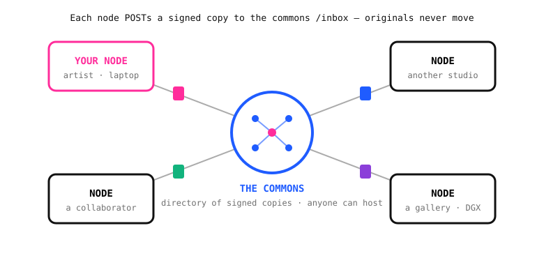
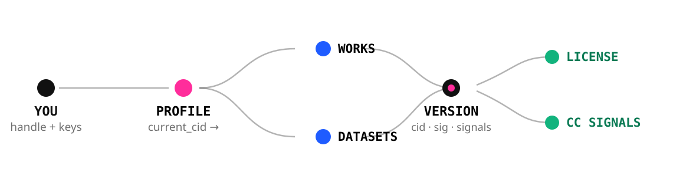
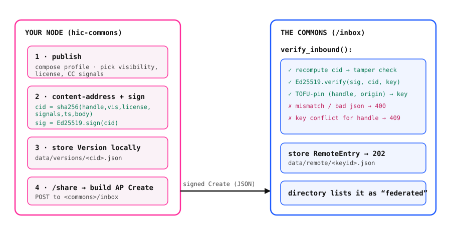
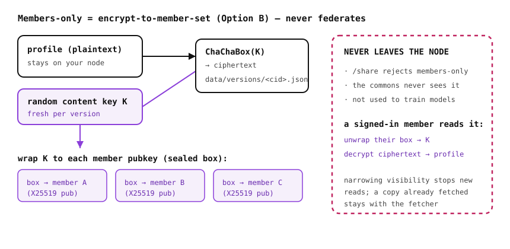

# Held in Common — Architecture

> A federated commons for creative work. Everyone runs their own **node** (a
> personal commons on hardware they control) and can **share signed copies** to
> a **commons** that anyone can host. Work stays on the node unless the owner
> sends a copy, and each version carries the terms (licence + CC signals) it
> travels under. Members-only work is **encrypted** and never leaves the node.

This document is for the people building on and operating Held in Common. For
*where things live in the code*, read [CODEMAP.md](CODEMAP.md); for *why* each
major choice was made, the [decision records](adr/README.md); for the exact
bytes that are signed, the [format specification](spec/README.md).

Current version: **0.8.2** (November 2026).

---

## 1. Topology

The same binary (`hic-commons`) is **both** a node and a commons. A **node** is
someone's own server: they create their identity there, publish, and share. A
**commons** is a shared directory: it has no sign-up, receives signed copies
from nodes at `/inbox`, checks them, and lists them. There is no central server.



| | Node | Commons |
|---|---|---|
| Who runs it | each person, usually in the desktop app | a host: a workshop leader, a collective, a server |
| Listens on | this computer only (`127.0.0.1`) | the network (`0.0.0.0`) |
| Identities | creates them (handle, keys, passphrase) | none: it only holds signed copies |
| Who's in charge | the member | its **steward** (whoever runs it) |

**Three reaches**, chosen per version:

| Reach | Listed | Search engines | Shared to a commons | At rest |
|---|---|---|---|---|
| **Public** | yes | allowed | yes, as a signed copy | plaintext |
| **Commons** | yes | asked not to (`noindex`) | yes, as a signed copy | plaintext |
| **Members only** | to this node's members | no | **never** | **encrypted** |

---

## 2. Components

```
commons/       hic-commons: the node + commons server (Rust, axum). One binary.
  src/         one module per job (see docs/CODEMAP.md)
  static/      the stylesheet and two small scripts, compiled in
  tests/       in-process HTTP tests and the format test vectors
src-tauri/     the desktop app: a Tauri shell that runs hic-commons as a sidecar
docs/          this document, CODEMAP, the install guide, decision records (adr/),
               the format spec (spec/), the November 2026 review, the slides
scripts/       test-federation.sh (end to end), check_spec_vectors.py (independent check)
```

### 2.1 `hic-commons` (the server)

An [axum](https://docs.rs/axum) server split into single-purpose modules.
Decisions are pure functions; every write happens in a clearly named place
([decision record 0016](adr/0016-no-hidden-effects.md)). Pages are rendered on
the server with [maud](https://docs.rs/maud); the only scripts are the photo
picker and the passphrase show/hide button.
Each page has its own file twice over: its body in `web/pages/` (pure) and
its handler in `web/handlers/`, so the site grows by adding files rather than
lengthening them. The stylesheet (`static/style.css`) is built on design
tokens (colours, type sizes, spacing) declared once at its top; components
read the tokens and share a few patterns (the mono label, buttons, panels),
so a change to a token restyles every page.

### 2.2 The desktop app (`src-tauri`)

A thin [Tauri v2](https://v2.tauri.app) shell, signed with a Developer ID and
notarized by Apple ([0015](adr/0015-macos-signing.md)).

- **First launch:** choose **a node** or **a commons**, then **name it**
  ("Studio laptop"). The name shows in the coloured bar and travels, signed,
  with every share; it is never the computer's account name. Rename any time
  from **This computer** in the sidebar. Roles and names are saved in `<app data>/app.json`;
  each has its own data folder (`node-data/`, `commons-data/`, `practice-data/`).
- **Side by side:** the other role can be added later, and a **local commons**
  (`practice` in code and folders, its first name) opened for a workshop or a
  session: anyone on the same Wi-Fi reaches it at this computer's address, and
  joining needs a vouch as anywhere else. The first-launch role
  keeps port 8080, the other gets 8081, practice 8082. The sidebar's **This computer** panel
  (and, on macOS, the **Go** menu in the menu bar) moves between them; a node's
  **Run a commons** page links into the app with `hic-app://open/…`
  ([0019](adr/0019-node-and-commons-side-by-side.md)).
- **Running the server:** the app starts the bundled `hic-commons` as a
  sidecar with a per-launch token, and opens a page only when `/health`
  echoes that token ([0008](adr/0008-app-trusts-only-its-server.md)). If the
  server crashes, the app restarts it (up to three times). A commons opens in
  its **steward view**.
- **Notifications and email:** the app shows the node's news (for example
  "now listed on …") as macOS notifications, and opens **Email this invite**
  links in the person's own mail app.
- **Logs:** `~/Library/Logs/org.heldincommon.node/held-in-common.log`.

---

## 3. Data model and storage

Everything hangs off a member's **handle**. Each publish makes a new
content-addressed, signed **version** carrying its own licence and signals.



Storage is plain JSON files under `$HIC_DATA` (default `./data`). Every write is
atomic (temporary file, flush, rename); a damaged file is an error, never
"missing". The member and shared-profile lists are cached in memory and the
cache is cleared by every write through the store.

```
instance.json              the folder's role ("node" | "commons"), fixed for the folder
handles/<handle>.json      a member: keys, passphrase hash (Argon2id), current version,
                           commons shared to, recovery key, pending key change, waiting_on
versions/<cid>.json        a signed version (plaintext, or encrypted copies for members)
notices.json               news for members (e.g. "now listed on …")       [node]
remote/<keyid>.json        a profile shared in and verified                [commons]
identities/<handle>.json   who holds each handle; recovery key; change history  [commons]
tombstones/<keyid>.json    what remains after a withdrawal                 [commons]
pending/<keyid>.json       shares waiting for a vouch or approval          [commons]
intros/<keyid>.json        how each person joined, and who vouched         [commons]
used-invites/, commons-invites/, founding-invite.json, steward.json        [commons]
```

Sessions live in memory and expire after 24 hours.

---

## 4. Publishing and sharing



1. **Publish** on the node: the profile, its reach, licence, signals and
   **Held in Common Signals**: the right to withdraw even after a model is
   trained, and the person's own terms for AI in their own words
   ([0025](adr/0025-held-in-common-signals.md)).
2. **Sign:** the version gets a content address (`cid`) and an Ed25519
   signature, and is stored on the node.
3. **Share:** the node sends a signed **`hic/v1` Profile** to the commons'
   `/inbox`. Every field is signed: the profile (picture included), display
   name, reach, licence, signals, encryption key, and the node's address and
   name ([spec §5.2](spec/README.md)). With Held in Common Signals chosen it
   is a **`ProfileV2`**, which signs them too ([spec §5.6](spec/README.md)).
   A commons that doesn't know a format answers 400 and gets the next older
   one (`ProfileV2` → `Profile` → version 0).
4. **Check:** the commons recomputes the content address and checks the
   signature (tampering → 400), then applies its rules:
   - a handle belongs to the first key that used it here; another key → 409
     ([0003](adr/0003-handles-unique-per-commons.md));
   - an older version than the one held, or one from before a withdrawal → 409
     ([0006](adr/0006-withdrawal-and-rollback.md));
   - a **new** handle needs a vouch (section 5).
5. **List:** the commons stores the copy and records who holds the handle
   (and the recovery key, if the share declared one).

Members-only versions are never sent.

### Stories: a copy, or a card

A **story** travels to a commons in one of two ways, the author's choice
("How it travels"):

- **a copy** ([0020](adr/0020-stories.md)): the commons keeps the signed
  story until it's withdrawn;
- **a card**, "Only while I'm here" ([0021](adr/0021-held-not-copied.md)):
  the commons keeps a signed **card** (title, author, first line, terms and
  the SHA-256 of the text, but not the text). The author's node keeps a
  long poll open to the commons (`/here/poll`; the node opens it, and still
  accepts nothing). When someone reads the story, the commons hands the
  request to that poll, checks the text the node sends against the card's
  signed hash, passes it to the reader and keeps nothing. When the node is
  away, readers see "Not here right now".

---

## 5. Joining a commons

A new handle is listed only when someone already there vouches for it
([0011](adr/0011-joining-needs-a-vouch.md), [0017](adr/0017-steward-approval.md)):

| Route | How |
|---|---|
| **Member's invite code** | a member presses **Invite someone**, sends the code (there's an **Email this invite** button), and the newcomer pastes it when they share |
| **Member's vouch** | the newcomer waits on the commons' list; a member who knows them presses **Vouch** beside them on the People tab of their own node ([0026](adr/0026-vouch-with-a-click.md)), or types their handle and key |
| **Steward approval** | the steward opens the **steward view** and presses **Approve** (or **Decline**) |
| **Steward's invite code** | the steward presses **Make an invite** in the steward view |
| **Founding invite** | a new commons makes a one-time code for its first person |

The **steward view** opens at the commons' own computer (the desktop app goes
straight there), or with the private **steward link** the commons prints in its
log (in the desktop app: **This computer → Show steward link…**; the app keeps it out of
its own log, ADR 0024). Each member can bring in `HIC_VOUCH_LIMIT` people a week (default 100).
`HIC_OPEN_COMMONS=1` turns vouching off. Everyone already listed stays.

**Seeing who is waiting** ([0026](adr/0026-vouch-with-a-click.md)): when a
member opens the People tab, their node asks each commons they're listed on
(`POST /api/waiting`), with a fresh `WaitingListRequest` signed by the
member's key. The commons answers only a key it lists, and only with each
person's handle, name and key, not their profile.

**Hearing you were listed** ([0018](adr/0018-hearing-you-were-listed.md)):
commons can't contact nodes, so a waiting node asks (`GET /api/status`) when it
starts and when the member presses **Check now**. A change becomes a banner on
the member's pages and a macOS notification.

---

## 6. Identity over time

- **Backups** ([0007](adr/0007-identity-backup.md)): **Download backup** saves
  the keys and current profile, encrypted with the passphrase; **Restore from
  a backup** on a new computer keeps the same keys, so every commons still
  recognises the handle.
- **Recovery key and key rotation** ([0010](adr/0010-recovery-key.md)): sign-up
  shows a recovery code once, to keep offline. **Replace my key** moves the
  handle to new keys on every commons shared to (kept pending until all
  accept). **Recover** with the code overrides any change made with a stolen
  key.
- **Withdrawal:** **Withdraw** asks a commons to remove the shared copy; it
  keeps a small tombstone so the handle stays yours and the old copy can't be
  replayed.

---

## 7. Members-only encryption

Each members-only version is encrypted once per member of the node with
`crypto_box` (X25519 + XChaCha20-Poly1305), using a one-time key per copy. It
never leaves the node. The node holds every member's keys, so this protects
copies outside the node, not against whoever runs it; the `/about` page says so.



---

## 8. Security model

- **Keys:** Ed25519 (signing) and X25519 (encryption) per handle, made and held
  by the member's node.
- **Signed formats:** written down in [spec/](spec/README.md): canonical JSON
  (RFC 8785), a type in every signature, test vectors checked in Rust and,
  independently, Python.
- **Passphrases:** Argon2id; five wrong tries per handle, then a 15-minute wait.
  Show/hide eye button in every passphrase box. No recovery of a forgotten
  passphrase.
- **Sessions:** `HttpOnly`, `SameSite=Lax` cookies (`Secure` on https), 24-hour
  expiry, a CSRF token on every form that changes something.
- **Network exposure:** a node listens only on its own computer
  ([0004](adr/0004-node-listens-only-locally.md)). A node reachable from the
  network won't share to internal addresses ([0012](adr/0012-block-internal-addresses-on-share.md)).
- **Abuse:** vouching for new handles; at most 120 `/inbox` and
  `/api/waiting` requests (counted together) per minute per address.
- **Crash safety:** atomic writes; clean shutdown on SIGTERM.
- **Web pages:** strict Content-Security-Policy; `X-Robots-Tag: noindex` for
  the Commons reach; `robots.txt`.

---

## 9. HTTP surface

| Method | Path | Purpose |
|---|---|---|
| GET | `/` | Directory (and, for the steward, the steward view) |
| GET | `/@{handle}`, `/federated/{keyid}` | A member's profile; a shared-in profile |
| GET/POST | `/join`, `/login`, POST `/logout` | Sign-up and sign-in (nodes only; a commons shows "run a node") |
| GET/POST | `/restore` | Restore an identity from a backup (nodes) |
| GET | `/new`, POST `/publish` | Publish a version |
| POST | `/share`, `/withdraw` | Share to / withdraw from a commons |
| POST | `/invite`, `/vouch` | Make an invite code; vouch for someone waiting |
| POST | `/waiting/check`, `/notices/dismiss` | Check now; hide the news banner |
| POST | `/backup`, `/recovery/new`, `/rotate`, `/recover` | Backup; recovery key; replace key; recover |
| POST | `/inbox` | Receive shares, withdrawals, vouches, key changes (commons) |
| POST | `/here/card`, `/here/poll` | "Only while I'm here": a node shares a story's card; a node's long poll (commons) |
| GET | `/stories/{keyid}/{id}/here.json` | A card and, if its author is here, the text, to check against the card (commons) |
| GET | `/steward`; POST `/steward/approve`, `/steward/decline`, `/steward/invite` | The steward view (commons) |
| GET | `/api/directory`, `/api/@{handle}`, `/api/handle/{h}`, `/api/pending`, `/api/status` | JSON |
| POST | `/api/waiting` | Who is waiting for a vouch, for a listed member's signed request (commons) |
| POST | `/api/notices/claim` | For the desktop app (needs its launch token) |
| GET | `/.well-known/webfinger`, `/ap/@{handle}`, `/ap/@{handle}/outbox` | ActivityStreams-shaped discovery (not full ActivityPub) |
| GET | `/health`, `/robots.txt`, `/style.css`, `/avatar.js`, `/password.js` | Housekeeping |

### Configuration

| Variable | Default | Meaning |
|---|---|---|
| `PORT` | `8080` | Port |
| `HIC_BIND` | node `127.0.0.1`, commons `0.0.0.0` | Address to listen on (Docker images set `0.0.0.0`) |
| `HIC_DATA` | `./data` | Data folder |
| `HIC_ROLE` | saved, else `node` | `node` or `commons`; fixed for the folder once saved |
| `HIC_INSTANCE` | `Held in Common` | This server's name |
| `HIC_BASE_URL` | `http://localhost:$PORT` | This server's public address |
| `HIC_ALSO_KNOWN_AS` | — | Other addresses it is reached at, comma separated (e.g. a room commons that is also public through Tailscale Funnel). Invites, vouches and withdrawals made for them count as addressed here. The app sets it from `public_address` in `app.json`. |
| `HIC_SHARE_DEFAULT` | *(blank)* | The commons a node offers first |
| `HIC_SHARE_DEFAULT_NAME` | *(blank)* | What pages call that commons ("Held in Common Collective Commons") instead of its address |
| `HIC_VOUCH_LIMIT` | `5` | People one member may bring in per week |
| `HIC_OPEN_COMMONS` | *(off)* | `1`: no vouching |
| `HIC_ALLOW_PRIVATE_SHARE` | *(off)* | `1`: a networked node may share to local-network addresses |
| `HIC_LAUNCH_TOKEN` | *(set by the app)* | Lets the desktop app recognise its own server |
| `HIC_SESSION_COOKIE` | `hic_session` | The sign-in cookie's name (the app gives each server on one computer its own) |
| `HIC_EXIT_WITH_APP` | *(off)* | `1`: stop when stdin ends; the desktop app sets it so a server never outlives the app (ADR 0027) |
| `HIC_ROOM_ADDRESS` | *(none)* | the address the room reaches a server at, for its room page and QR code (ADR 0027) |
| `HIC_ROOM_CODE` | *(none)* | on a local commons open to the room, the code that admits people (ADR 0027) |
| `HIC_FIREWALL_HINT` | *(none)* | a hint about this computer's firewall, shown on the room page (ADR 0027) |
| `HIC_ROOM` | *(off)* | `1`: open to the room (ADR 0027): the door lets the room's network reach only public pages on a node, and not the host's pages on a commons |
| `HIC_PRACTICE` | *(off)* | `1`: a local commons (once "practice"); its pages say so and show its Wi-Fi address |
| `HIC_RELAY_HOLD`, `HIC_RELAY_WAIT` | `25`, `8` | Seconds a commons holds a node's "Only while I'm here" poll open, and a reader waits for the node (1–60) |

---

## 10. Build, run, test

```
cargo run --manifest-path commons/Cargo.toml                 # a node at http://127.0.0.1:8080
cargo test --manifest-path commons/Cargo.toml                # unit + HTTP + format vectors
cargo test --manifest-path src-tauri/Cargo.toml              # desktop app rules
cargo build --release --manifest-path commons/Cargo.toml && ./scripts/test-federation.sh
python3 scripts/check_spec_vectors.py                        # the format, checked in Python
```

All of these run on every pull request. See [CONTRIBUTING.md](../CONTRIBUTING.md).

---

## 11. Not built yet

- Automatic app updates ([0014](adr/0014-automatic-updates.md), issue #17).
- Dataset listings, rights records, licences, adapters and model versions as
  `hic/v1` objects, for the BRAID work ([review §4](REVIEW-2026-11.md)).
- Windows and Intel-Mac builds.
- A database instead of files, if commons grow to many thousands of profiles.
