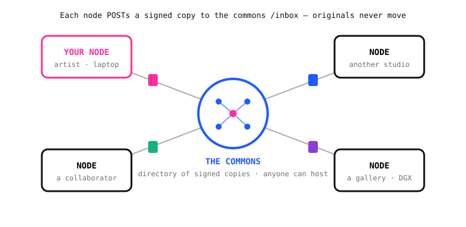
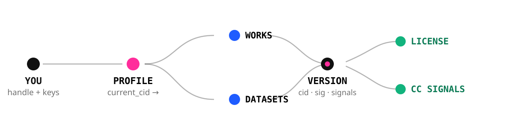
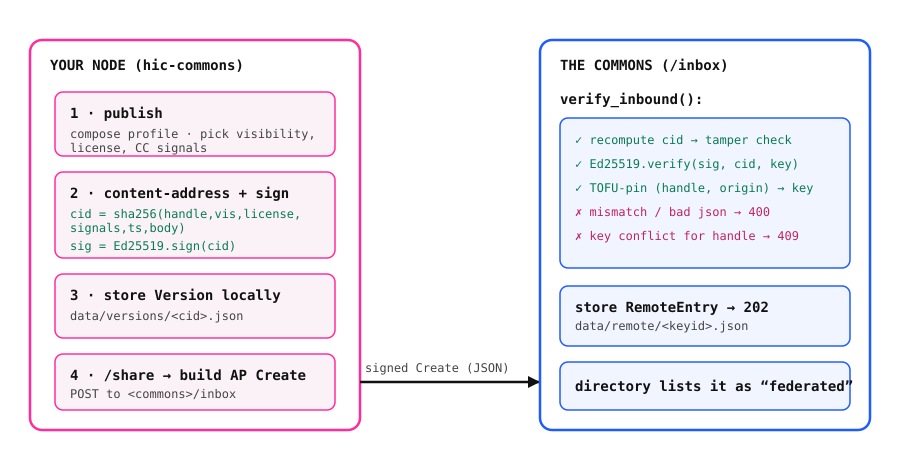
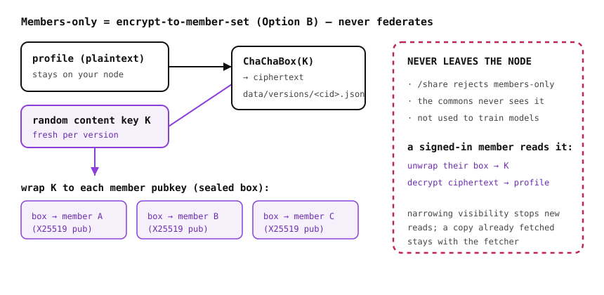

# Held in Common — Architecture

> A federated commons for creative work. Everyone runs their own **node** (a
> personal commons on hardware they control) and can **share signed copies** to a
> **commons** that anyone can host. Work stays on the node unless the owner sends
> a copy, and each version carries the terms (license + CC signals) it travels
> under. Members-only work is **encrypted** and never leaves the node readable.

This document is for the dev teams building on and operating Held in Common.

---

## 1. Topology

The same binary (`hic-commons`) is **both** a node and a commons — a commons is
just a node that others point at. Nodes publish locally and federate signed
copies to one or more commons; the commons aggregates them into a browsable
directory. There is no central server and no landlord.



**Three visibility reaches**, chosen per version:

| Reach | Listed | Searchable | Federates | At rest |
|---|---|---|---|---|
| **Public** | yes | yes | yes (signed copy) | plaintext |
| **Commons** | yes | no (shared by link) | yes (signed copy) | plaintext |
| **Members-only** | to members | no | **never** | **encrypted** |

---

## 2. Components

```
commons/       hic-commons — the node + commons server (Rust / axum). One binary.
src-tauri/     the native desktop app: a Tauri shell that runs hic-commons as a sidecar.
docs/          this doc, the workshop INSTALL guide, the reveal.js architecture slides.
node/ , src/   legacy Leptos onboarding prototype (Docker-based, :4321). Superseded;
               kept for reference only. The current product is commons/ + src-tauri/.
scripts/       test-federation.sh — the end-to-end federation test.
```

### 2.1 `hic-commons` (the server)
A single self-contained [axum](https://docs.rs/axum) service. Responsibilities:
identity + auth, content-addressed signed publishing, the three visibility tiers
(incl. members-only encryption), CC governance metadata, the directory + profile
pages (server-rendered with [maud](https://docs.rs/maud)), a small JSON API, and
the federation endpoints (ActivityPub-shaped actor/outbox/WebFinger + `/inbox`).

### 2.2 Desktop app (`src-tauri`)
A thin [Tauri v2](https://v2.tauri.app) shell. On launch it starts the bundled
`hic-commons` binary as a **sidecar** (`tauri-plugin-shell`), shows an on-brand
loading screen, polls `http://localhost:8080/health`, then hands off to the
node's own web UI. No Docker, no terminal — double-click and you are a node. The
sidecar binary (`binaries/hic-commons-<target-triple>`) is gitignored and built
+ copied by CI (and by the from-source steps in the README).

---

## 3. Data model

Everything an artist holds hangs off their **handle**. A **profile** points at its
current **version**; every publish mints a new content-addressed, signed version
that carries its own license and CC signals. (Works/datasets are modelled the
same way; profiles are the first object type implemented.)



**On-disk layout** (filesystem under `$HIC_DATA`, default `./data`):

```
data/
  handles/<handle>.json     identity: display name, Ed25519 + X25519 keys, current_cid, shared_to[]
  versions/<cid>.json       a signed version (plaintext profile, or encrypted member boxes)
  remote/<keyid>.json       a RemoteEntry federated in from another node (verified + key-pinned)
```
Sessions are in-memory (cookie token → handle + per-session CSRF).

---

## 4. Publish + federation flow

Publishing is local and content-addressed; federation is an explicit, signed push
that the receiving commons independently verifies.



1. **Publish** — the node builds the profile, picks visibility/license/signals.
2. **Content-address + sign** — `cid = sha256(handle, visibility, license, signals, created_at, body)`; `sig = Ed25519.sign(cid)`. The `cid` is the version's permanent identity; the signature binds it to the handle's key.
3. **Store** locally as a `Version`.
4. **Share** — build an ActivityPub-shaped `Create` and `POST` it to `<commons>/inbox`.
5. **Verify (`verify_inbound`)** — the commons **recomputes the `cid`** from the sent content (tamper check), **verifies the Ed25519 signature**, and **TOFU-pins** the `(handle, origin)` pair to the first key it saw. Mismatch or malformed → **400**; a handle re-appearing under a different key for the same origin → **409**. On success it stores a `RemoteEntry` and returns **202**, and the directory lists it as *federated* (not re-hosted as local).

Identity is the handle's **public key**, so this works for laptops with no public
URL (NAT-friendly). Narrowing a version's visibility stops the commons serving it,
but a copy already fetched stays with the fetcher — content-addressing is
append-only by nature.

---

## 5. Members-only encryption (Option B)

Members-only is **encrypt-to-member-set**: a fresh random content key encrypts the
profile; that key is wrapped to each member's public key with a sealed box. The
ciphertext lives on the node and **never federates**.



- Encryption: `crypto_box` **ChaChaBox** (X25519 + XChaCha20-Poly1305).
- The node holds each member's encryption **public** key; only a signed-in member can unwrap the content key with their secret key and decrypt.
- `/share` rejects members-only outright — it is never sent, never seen by a commons, never used to train a model.

---

## 6. Security model

- **Keys** — each handle gets an Ed25519 signing keypair and an X25519 encryption keypair, minted and held by the node; users never touch a private key.
- **Integrity / authenticity** — content-addressing (sha256) + Ed25519 signatures. A single changed character breaks the `cid` and the signature → rejected at `/inbox`.
- **Federation trust** — TOFU key pinning per `(handle, origin)`; conflicting keys are refused (409). *P2: reachable-origin verification by fetching `<origin>/ap/@handle`.*
- **Auth** — passphrase (stored only as a salted hash; no recovery) → session cookie (`HttpOnly`, `SameSite=Lax`, `Secure`) + a per-session **CSRF** token guarding `publish`/`share`.
- **Confidentiality** — members-only ciphertext at rest; the content key is never stored unwrapped.
- **Input hardening** — handles validated (`[a-z0-9_]{2,30}`) and path-traversal-guarded before becoming filenames.

---

## 7. HTTP surface

| Method | Path | Purpose |
|---|---|---|
| GET | `/` | Directory (local + federated) |
| GET | `/about` | How it works |
| GET/POST | `/join` | Create a handle (mints keys, starts session) |
| GET | `/new` | Publish / edit form (auth) |
| POST | `/publish` | Create a signed version (auth + CSRF) |
| POST | `/share` | Federate a signed copy to a commons (auth + CSRF) |
| POST | `/inbox` | Receive + verify a federated share |
| GET | `/federated/{keyid}` | View a federated-in profile |
| GET/POST | `/login`, POST `/logout` | Session |
| GET | `/@{handle}` | Profile page |
| GET | `/health` | Liveness (used by the desktop app) |
| GET | `/api/directory`, `/api/@{handle}` | JSON |
| GET | `/.well-known/webfinger`, `/ap/@{handle}`, `/ap/@{handle}/outbox` | ActivityPub discovery |

### Configuration (env)

| Variable | Default | Meaning |
|---|---|---|
| `PORT` | `8080` | Listen port (binds `0.0.0.0`) |
| `HIC_DATA` | `./data` | Data directory |
| `HIC_INSTANCE` | `My node` | Human label |
| `HIC_SHARE_DEFAULT` | *(blank)* | Commons pre-filled in the share form |
| `HIC_BASE_URL` | `http://localhost:$PORT` | Public base URL for federation/ActivityPub |

---

## 8. Tech stack

Rust · axum 0.8 · tokio · maud (server-rendered HTML) · ed25519-dalek ·
crypto_box (ChaChaBox / X25519) · sha2 · reqwest (rustls) · Tauri v2 +
tauri-plugin-shell. Zero client JS framework in the product path (the server
renders HTML; the desktop shell is a thin loader).

---

## 9. Build, run, test

```
# run a node / commons
cargo run --manifest-path commons/Cargo.toml          # → http://localhost:8080

# desktop app from source (see README for the sidecar copy step)
cargo tauri build

# end-to-end federation test (publish → sign → federate, tamper→400, members guard)
./scripts/test-federation.sh
```

---

## 10. Known gaps / roadmap

- Reachable-origin verification (fetch `<origin>/ap/@handle` to confirm the key) and unshare/revoke.
- Fan-out to multiple commons; works/datasets payloads (profiles land first).
- Signed desktop builds (Apple notarization / Windows cert) — preview builds are unsigned today.
- Durable storage for hosted commons (the preview pods use ephemeral disk).
