# ActivityPub vs Held in Common: how each federates

This document compares ActivityPub with the federation in Held in Common
(`HeldInCommon/FederatedBios`, version 0.9.3), one concern at a time. Each section
shows the ActivityPub way first, then the Held in Common way, then what differs.
The Held in Common diagrams follow `docs/ARCHITECTURE.md`, `docs/spec/README.md` and
`commons/src/web/handlers/inbox.rs`.

## Contents

1. [At a glance](#1-at-a-glance)
2. [Shape of the network](#2-shape-of-the-network)
3. [Identity and discovery](#3-identity-and-discovery)
4. [Verifying a message](#4-verifying-a-message)
5. [Connecting: following vs joining](#5-connecting-following-vs-joining)
6. [Publishing and delivery](#6-publishing-and-delivery)
7. [The inbox](#7-the-inbox)
8. [Changing and removing things](#8-changing-and-removing-things)
9. [Only in Held in Common](#9-only-in-held-in-common)
10. [Where the two meet](#10-where-the-two-meet)

---

## 1. At a glance

| Concern | ActivityPub | Held in Common |
|---|---|---|
| Who runs a server | Instance admins, hosting many users | Everyone runs a **node** on their own computer; anyone can host a **commons** |
| Direction of traffic | Server to server, both ways | Node to commons only; a commons never contacts a node |
| Identity | Actor URL on a server; the server holds the keys | Ed25519 key made and held on the person's node; a handle belongs to the first key to use it on each commons |
| What is signed | The HTTP request (HTTP Signatures) | The object itself, by its content address, so stored copies stay verifiable |
| Getting the key | Receiver fetches it from the actor's `keyId` | Travels inside the signed object (`envelope.author`) |
| Audience | Follow graph; delivery fans out to followers | No follows; the owner picks which commons get a copy |
| Admission | Open by default, moderation after | New handles need an invite, a vouch or steward approval |
| Updates | `Update` replaces the object | Each version is new and signed, and must be strictly newer than what the commons holds |
| Deletion | `Delete`, best effort | `Withdraw` leaves a tombstone that blocks replay |
| Private content | Addressed delivery (`to`/`cc`) to chosen inboxes | Members-only work is encrypted and never leaves the node |
| Content not held | Not a concept | "Only while I'm here": the commons holds a signed card and fetches the text from the node each time |

---

## 2. Shape of the network

### ActivityPub

Every server can push to every other server's inboxes, and pull objects by URL.

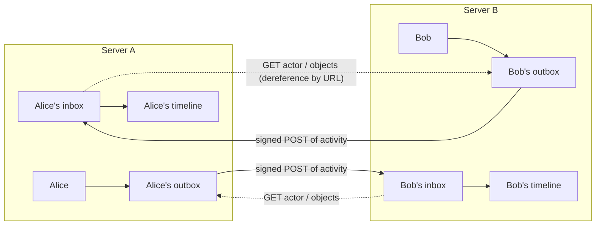

### Held in Common

The same binary runs as a node or a commons. Nodes listen only on their own computer
(`127.0.0.1`), so all traffic starts at the node. Readers browse a commons.

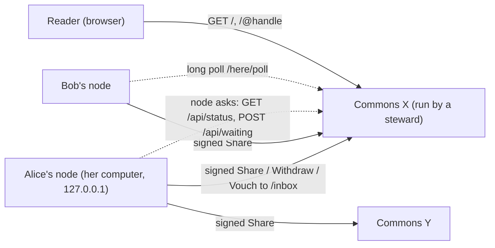

### What differs

ActivityPub is a mesh of peers. Held in Common is a star around each commons with
one-way arrows: anything a node needs to hear (that it was listed, that someone wants
to read a story) it gets by asking. This is why a node can sit behind a home router
with no open ports.

---

## 3. Identity and discovery

### ActivityPub

A user is an actor document at a URL on their server. Other servers find it through
WebFinger and read the public key from it.

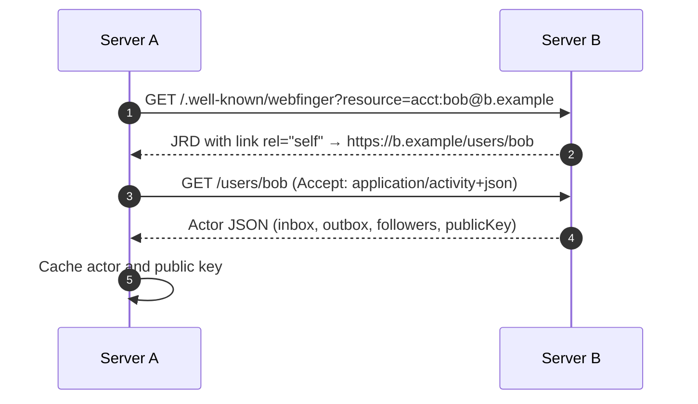

### Held in Common

A person's identity is a key pair made on their own node. A handle is claimed per
commons, by the first key that shares under it there.

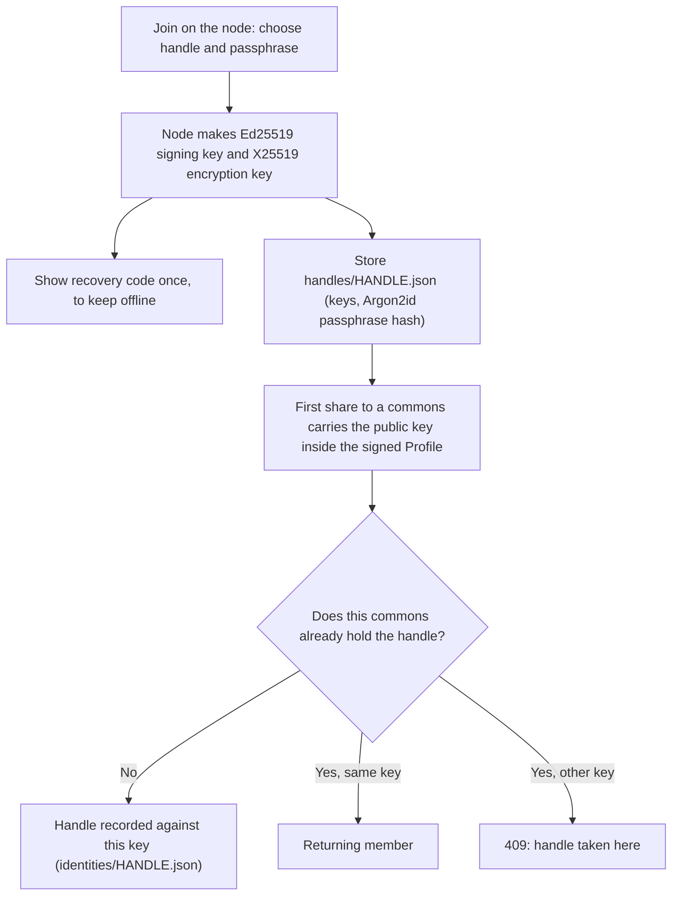

### What differs

In ActivityPub the server is the identity's home and holds its keys; moving server
means a new identity. In Held in Common the key is the identity and lives with the
person; backups, key rotation and a recovery key carry it between computers, and the
same handle can mean different people on different commons.

---

## 4. Verifying a message

### ActivityPub

The signature covers the HTTP request. The receiver has to fetch the sender's key.

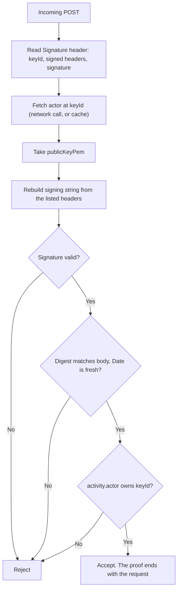

### Held in Common

The signature covers the object's content address. Everything needed to check it is
inside the object (spec §2).

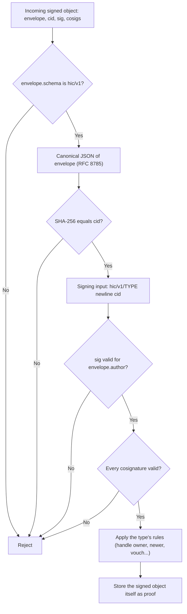

### What differs

ActivityPub proves *who sent this request*; Held in Common proves *who made this
object*. Because the type is part of the signing input, a signature for one kind of
object can't be passed off as another. A copy held on a commons can be re-checked by
anyone later, and a commons can't alter a profile without breaking its signature.

---

## 5. Connecting: following vs joining

### ActivityPub: following someone

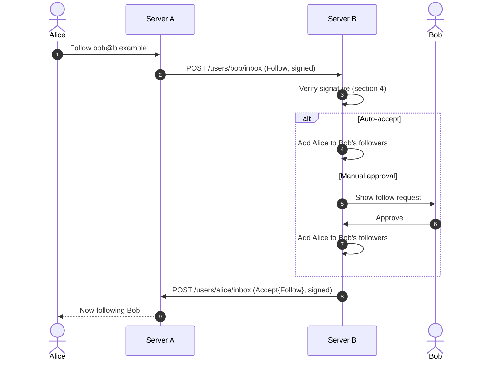

### Held in Common: joining a commons

There are no follows. The relationship is between a person and a commons, and a new
handle is listed only once someone already there vouches for it.

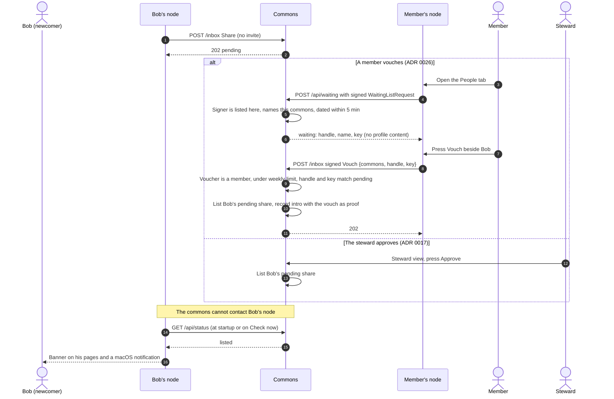

Other routes in: a member's invite code, a steward's invite code, the commons' one-time
founding invite, or a room code on a local commons. `HIC_OPEN_COMMONS=1` turns the
gate off.

### What differs

A follow is person-to-person and decides whose posts you receive. Joining is
person-to-community and decides whether you are listed at all. ActivityPub tells the
follower through an `Accept`; Held in Common can't push, so the node polls
`/api/status`.

---

## 6. Publishing and delivery

### ActivityPub

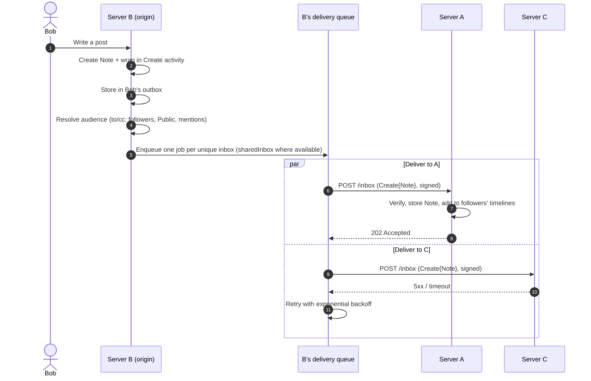

### Held in Common

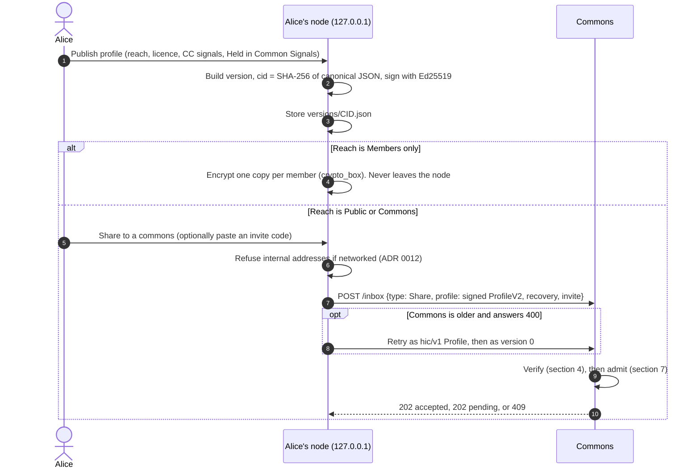

### What differs

ActivityPub publishes once and the server fans out to every follower's inbox, retrying
in the background. Held in Common shares are explicit, one commons at a time, chosen
by the person, and the licence and signals travel signed inside every copy. Sharing
also degrades gracefully: a node steps down through older formats when a commons
hasn't been upgraded.

---

## 7. The inbox

### ActivityPub

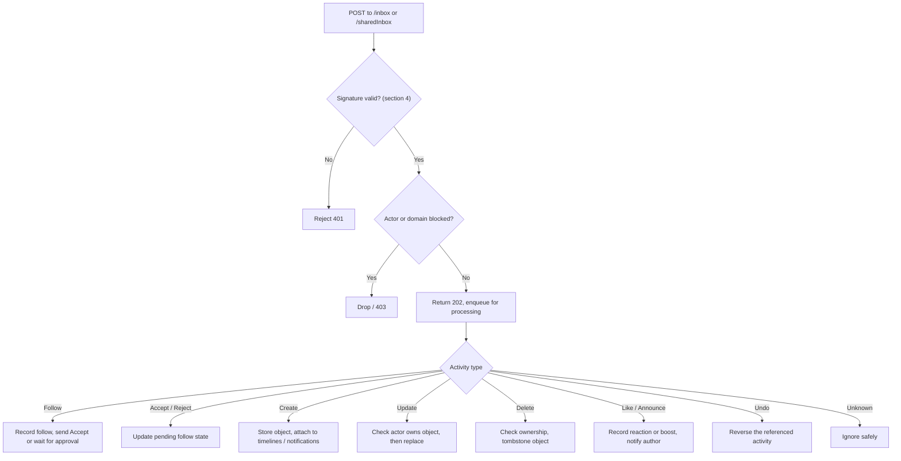

### Held in Common (commons only)

Follows the dispatch order in `inbox.rs`.

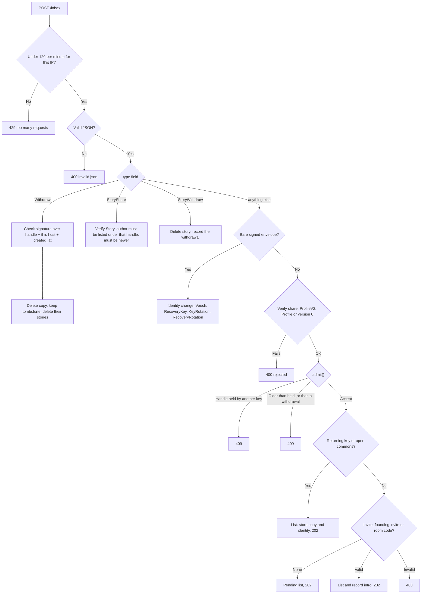

### What differs

ActivityPub accepts first and processes later, ignoring types it doesn't know. Held in
Common decides synchronously and answers with a meaningful status, and refuses types
it doesn't understand rather than guessing (spec §4). Unknown formats get a 400,
which is what tells the node to fall back to an older one.

---

## 8. Changing and removing things

### ActivityPub: update and delete

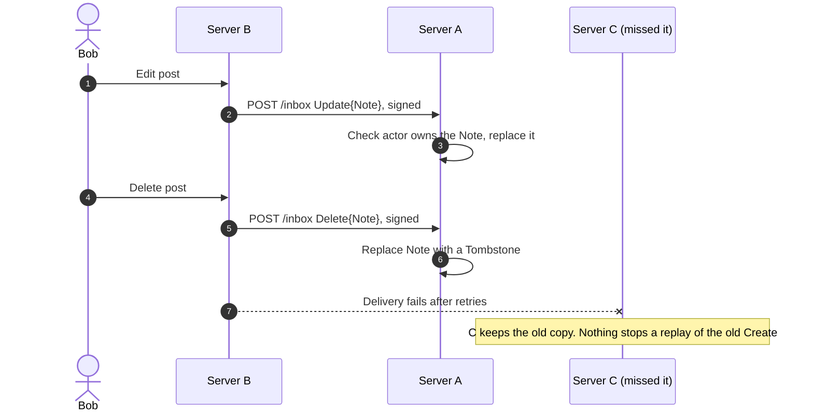

### Held in Common: withdrawal and key replacement

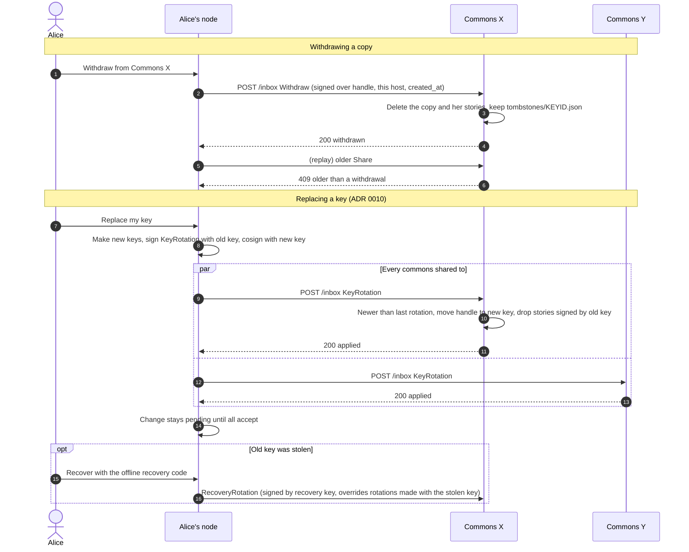

### What differs

ActivityPub edits replace an object in place, and deletes are best effort. Held in
Common versions are immutable; "newer" is enforced on every commons, and a withdrawal
leaves a tombstone so an old copy can't be sent again. ActivityPub has no standard way
to move an identity to a new key; Held in Common has rotation, plus a recovery key
that outranks a stolen one.

---

## 9. Only in Held in Common

### "Only while I'm here" stories

The commons holds a signed card but not the text, and fetches the text through a
connection the author's node keeps open.

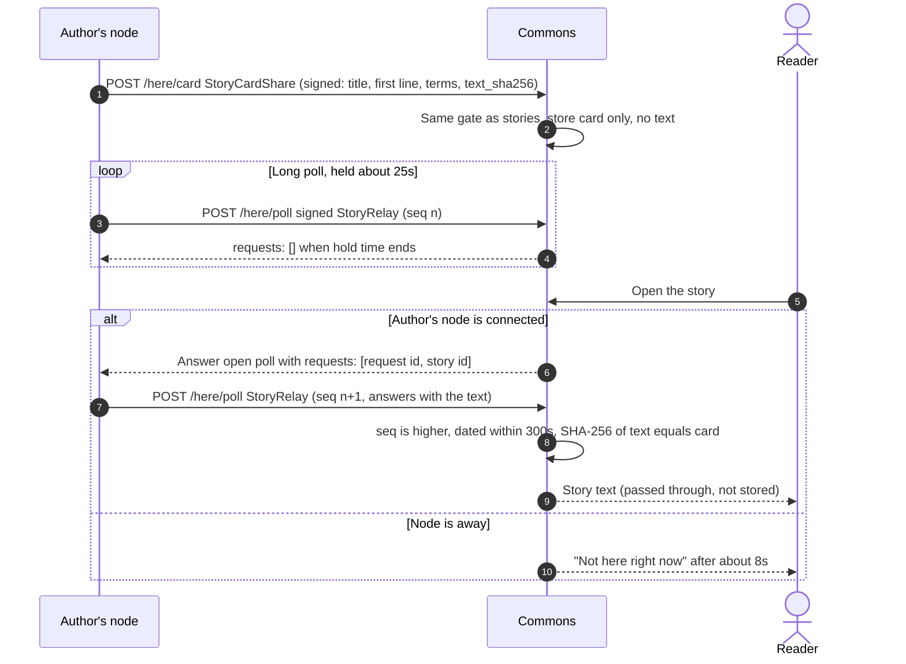

### Members-only encryption

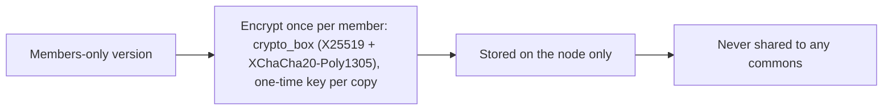

ActivityPub's closest equivalent is addressing a post to specific inboxes, which still
hands a plaintext copy to every receiving server.

---

## 10. Where the two meet

Held in Common exposes read-only, ActivityStreams-shaped discovery so other tools can
find a member: `GET /.well-known/webfinger`, `GET /ap/@HANDLE` and
`GET /ap/@HANDLE/outbox`. It does not accept ActivityPub activities, send them, or
take part in follows, so a Mastodon server can look someone up but can't federate
with a commons.
