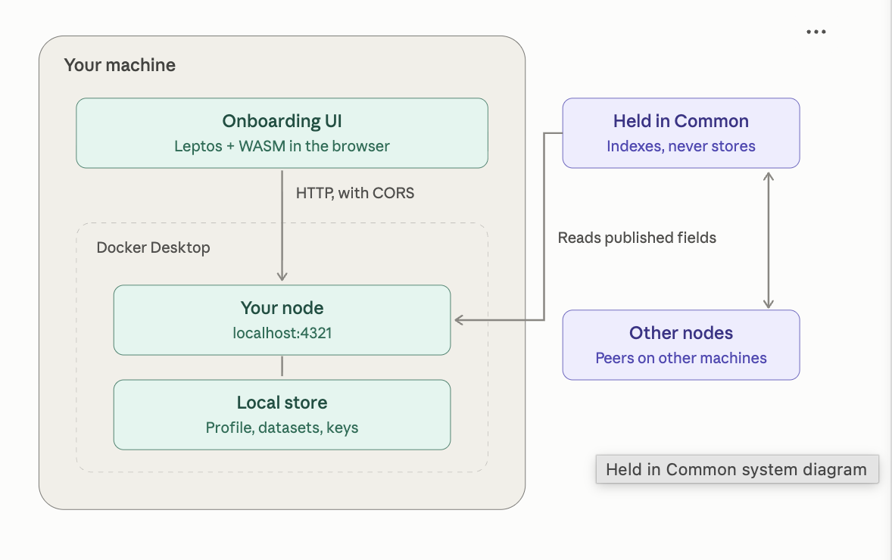

# Held in Common — onboarding (Leptos)

A client-side Leptos 0.8 app for setting up a local node, a small Tauri shell
that lets it run Docker, and the node itself.

## Layout

```
node/          the local node: an HTTP service on :4321, built into the heldincommon/node image
src/           the onboarding UI (Leptos, compiled to WASM by Trunk)
src-tauri/     the desktop shell: Rust commands that call the Docker CLI
```

- `src/check.rs`: the `Check` card and `CheckState` (pending / ok / failed). Presentational only.
- `src/probes.rs`: one async fn per check. `docker()` and `image()` call Tauri commands;
  `node()` polls `http://localhost:4321/health`.
- `src/onboarding.rs`: wires the three checks, the stepper, and the gated "Set up your profile" button.
- `src-tauri/src/docker.rs`: `status`, `start_node` and `logs`, which shell out to `docker`.
- `node/src/main.rs`: answers `GET /health` with CORS headers for the UI's origins.

## Prerequisites

```
rustup target add wasm32-unknown-unknown
cargo install trunk --locked
cargo install tauri-cli --version "^2" --locked
```

Docker Desktop must be installed. On Linux, Tauri also needs the webview
libraries (on Debian/Ubuntu: `libwebkit2gtk-4.1-dev librsvg2-dev libxdo-dev libssl-dev`).

## 1. Build the node image

The image is not on a registry yet, so build it locally. `start_node` only pulls
when the image is missing, so a local build is enough.

```
docker build -t heldincommon/node ./node
```

## 2a. Run the desktop app (all three checks are real)

```
cargo tauri dev
```

This starts `trunk serve` on 127.0.0.1:8080 and opens the app window. The app
checks Docker, starts the `hic-node` container (or reuses it), then polls the node.

## 2b. Or run in a browser (only the node check is real)

A browser tab can't run Docker, so the first two cards report "Skipped in the
browser". Start the container yourself, then serve the UI:

```
docker run -d --name hic-node -p 4321:4321 -v hic-node-data:/data --restart unless-stopped heldincommon/node
trunk serve --open
```

## Useful commands

```
curl -i -H "Origin: http://127.0.0.1:8080" http://localhost:4321/health   # health + CORS header
docker logs hic-node                                                      # node output
docker rm -f hic-node                                                     # reset; the data volume is kept
docker volume rm hic-node-data                                            # wipe the local store
```

To see the failure states in the app, quit Docker Desktop and press "Try again".

## System Diagram



## Notes

- The node must send CORS headers for the page's origin, or the health check fails.
  The allowed origins default to `trunk serve` and Tauri's webview; override them with
  `ALLOWED_ORIGINS` (comma-separated) on the container.
- The node binds `0.0.0.0` inside the container. Binding `127.0.0.1` would make it
  unreachable from the host even with `-p 4321:4321`.
- The volume `hic-node-data` is mounted at `/data`, ready for the local store
  (profile, datasets, keys). Nothing writes to it yet.
- The icons in `src-tauri/icons` are placeholders. Replace them with
  `cargo tauri icon path/to/logo.png`.
- Not built yet: draft endpoints on the node, so `profile.rs` and `visibility.rs` can
  stop using localStorage, and a log panel (View log prints to the console for now).
